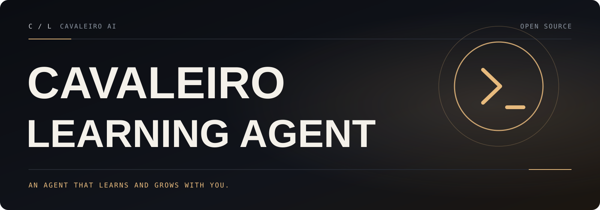

[English](README.md) · **Português (Brasil)**

<a id="top"></a>

<p align="center">
  
</p>

# Cavaleiro Learning Agent

**Um agente pessoal de IA que se aprimora sozinho: aprende com a experiência, lembra entre sessões e roda onde você trabalha.**

<p align="center">
  <a href=".github/workflows/ci.yaml"></a>
  &nbsp;
  <a href="LICENSE"></a>
  &nbsp;
  <a href="CHANGELOG.md"></a>
</p>

O Cavaleiro Learning Agent é mantido pela [Cavaleiro AI](https://github.com/cavaleiro-ai). Ele mantém todos os recursos do projeto original (veja [Licença](#licença)) e acrescenta correções de segurança e de confiabilidade, cada uma comprovada por um teste de regressão (veja [O que o Cavaleiro Learning Agent acrescenta](#o-que-o-cavaleiro-learning-agent-acrescenta)).

O agente tem um ciclo de aprendizado embutido: cria habilidades (skills) a partir da experiência, melhora essas habilidades enquanto as usa, mantém uma memória curada, pesquisa as próprias conversas anteriores e constrói, sessão após sessão, um modelo de quem você é. Rode em uma VPS pequena, em uma máquina com GPU ou em infraestrutura serverless, e converse com ele pelo terminal ou pelo Telegram, Discord, Slack, WhatsApp, Signal e outros.

Use o modelo que quiser: Nous Portal, OpenRouter, OpenAI, Anthropic, um servidor llama.cpp local, seu próprio endpoint e muitos outros. Troque com `hermes model`, sem mudar código.

<table>
<tr><td><b>Uma interface de terminal de verdade</b></td><td>TUI completa com edição em várias linhas, autocompletar de comandos de barra, histórico, interromper e redirecionar, e saída de ferramentas em tempo real.</td></tr>
<tr><td><b>Está onde você está</b></td><td>Telegram, Discord, Slack, WhatsApp, Signal, e-mail e a CLI, todos a partir de um único processo de gateway. Transcrição de áudios e continuidade da conversa entre plataformas.</td></tr>
<tr><td><b>Um ciclo de aprendizado fechado</b></td><td>Memória curada pelo próprio agente, com lembretes periódicos. Criação autônoma de habilidades depois de tarefas complexas, e habilidades que melhoram com o uso. Busca FTS5 nas sessões com resumo por LLM. Compatível com o padrão aberto <a href="https://agentskills.io">agentskills.io</a>.</td></tr>
<tr><td><b>Automações agendadas</b></td><td>Agendador cron embutido com entrega em qualquer plataforma: relatórios diários, backups noturnos, auditorias semanais, escritos em linguagem natural e executados sem supervisão.</td></tr>
<tr><td><b>Delega e paraleliza</b></td><td>Subagentes isolados para frentes de trabalho em paralelo, e scripts Python que chamam ferramentas por RPC.</td></tr>
<tr><td><b>Roda em qualquer lugar</b></td><td>Sete backends de terminal: local, Docker, SSH, Singularity, Modal, Daytona e Vercel Sandbox.</td></tr>
<tr><td><b>Execução de ferramentas protegida</b></td><td>Detecção de comandos perigosos, uma lista de bloqueio incondicional (hardline), suas próprias regras <code>approvals.deny</code>, pareamento por DM e isolamento em contêiner.</td></tr>
</table>

---

## Instalação

Este repositório é instalado a partir do código-fonte. Os comandos, os arquivos de configuração e a pasta de dados são os mesmos do projeto original (veja [Compatibilidade](#compatibilidade)).

> Os instaladores de uma linha do projeto original instalam o projeto original, não este repositório. Instale a partir do código-fonte, como mostrado abaixo.

**Requisitos:** Git (com `git-lfs`) e conexão com a internet na primeira configuração. O script de setup prepara o próprio `uv` e o Python 3.14 fixados no projeto; você não precisa instalar Python antes.

### Linux, macOS, WSL2

```bash
git clone https://github.com/cavaleiro-ai/cavaleiro-learning-agent.git
cd cavaleiro-learning-agent
./setup-hermes.sh          # prepara uv + Python 3.14 e as dependências travadas
source ./activate          # coloca o `hermes` deste checkout no seu shell
hermes setup               # escolha provedor, modelo e ferramentas
hermes                     # comece a conversar
```

### Windows (nativo, PowerShell)

```powershell
git clone https://github.com/cavaleiro-ai/cavaleiro-learning-agent.git
cd cavaleiro-learning-agent
.\setup-hermes.ps1
. .\activate.ps1           # o ponto e o espaço no início são obrigatórios
hermes setup
hermes
```

Use `deactivate` para sair do ambiente. Para manter experimentos longe dos seus dados reais, defina `HERMES_HOME` para outra pasta antes do primeiro `hermes setup`. O [guia em português](docs/cavaleiro/GUIA-PT-BR.md) explica cada passo no Windows, macOS e Linux, inclusive a solução de problemas.

### O Windows Defender acusa o `uv.exe`

Alguns antivírus colocam em quarentena o `uv.exe`, o gerenciador de pacotes da Astral (escrito em Rust) que o setup usa para gerenciar o Python. É um falso positivo conhecido para binários Rust sem assinatura. Verifique o binário com a atestação de release da Astral (`gh attestation verify <zip> --repo astral-sh/uv`) e, se conferir, crie a exceção para a pasta (não para o hash do arquivo, que muda a cada versão do `uv`). Veja [astral-sh/uv#13553](https://github.com/astral-sh/uv/issues/13553).

---

## Primeiros passos

```bash
hermes              # CLI interativa: comece uma conversa
hermes model        # Escolha o provedor e o modelo de LLM
hermes tools        # Configure quais ferramentas ficam ativas
hermes config set   # Altere um valor de configuração
hermes config get   # Mostre um valor de configuração
hermes gateway      # Inicie o gateway de mensagens (Telegram, Discord etc.)
hermes setup        # Rode o assistente de configuração completo
hermes doctor       # Diagnostique problemas
```

### Referência rápida: CLI e aplicativos de mensagem

Abra a interface de terminal com `hermes`, ou rode o gateway e converse com o agente por um aplicativo de mensagens. Muitos comandos de barra funcionam nos dois.

| Ação | CLI | Plataformas de mensagem |
|---|---|---|
| Começar a conversar | `hermes` | `hermes gateway setup` + `hermes gateway start`, depois mande mensagem para o bot |
| Começar uma conversa nova | `/new` ou `/reset` | `/new` ou `/reset` |
| Trocar o modelo | `/model [provedor:modelo]` | `/model [provedor:modelo]` |
| Definir uma personalidade | `/personality [nome]` | `/personality [nome]` |
| Repetir ou desfazer a última rodada | `/retry`, `/undo` | `/retry`, `/undo` |
| Comprimir o contexto ou ver o uso | `/compress`, `/usage`, `/insights [--days N]` | `/compress`, `/usage`, `/insights [dias]` |
| Ver habilidades | `/skills` ou `/<nome-da-skill>` | `/<nome-da-skill>` |
| Interromper o trabalho atual | `Ctrl+C` ou mande uma nova mensagem | `/stop` ou mande uma nova mensagem |

### Onde ficam os seus dados

| Caminho | Para que serve |
|---|---|
| `~/.hermes/config.yaml` | Configurações: modelo, backend de terminal, toolsets, aprovações, compressão |
| `~/.hermes/.env` | Somente chaves de API e outros segredos |
| `~/.hermes/memories/` | Memória persistente (`MEMORY.md`, `USER.md`) |
| `~/.hermes/skills/` | Habilidades embutidas, instaladas do hub e criadas pelo agente |
| `~/.hermes/state.db` | Banco SQLite das sessões, com busca de texto completo |
| `~/.hermes/cron/` | Tarefas agendadas |

No Windows nativo a pasta padrão é `%LOCALAPPDATA%\hermes`. `HERMES_HOME` muda essa pasta, e cada perfil tem a sua.

### Controles de segurança que vale conhecer

- `approvals.mode` no `config.yaml` (`manual`, `smart` ou `off`) decide quando um comando de terminal arriscado precisa da sua aprovação. A lista hardline e as suas regras `approvals.deny` valem mesmo no modo `off` e com `--yolo`.
- O backend de terminal decide onde os comandos rodam. `local` roda na sua máquina, com o seu usuário; `docker`, `ssh`, `modal`, `daytona`, `singularity` e `vercel` isolam a execução.
- As plataformas de mensagem só respondem a usuários da lista de permissão ou pareados. Mantenha essas listas enxutas.

---

## Documentação

| Documento | O que cobre |
|---|---|
| [Guia em português](docs/cavaleiro/GUIA-PT-BR.md) | O que é o agente, arquitetura, instalação passo a passo no Windows/macOS/Linux, primeiros passos, configuração, solução de problemas, como contribuir |
| [Relatório de engenharia](docs/cavaleiro/ENGINEERING.md) (inglês) | Mapa da arquitetura, linha de base dos testes, cada achado e correção com a evidência, limitações conhecidas |
| [Changelog](CHANGELOG.md) | O que mudou em cada versão do Cavaleiro |
| [`website/docs/`](website/docs/) | A documentação completa de uso e de desenvolvimento (fontes do Docusaurus, em inglês), que vale comando por comando |
| [AGENTS.md](AGENTS.md) | O guia de desenvolvimento para pessoas e agentes de código que trabalham nesta árvore |

---

## O que o Cavaleiro Learning Agent acrescenta

Tudo do projeto original, mais correções que vêm, cada uma, com um teste de regressão que falha no código original e passa aqui. Detalhes e evidências estão no [changelog](CHANGELOG.md#cavaleiro-learning-agent-100--2026-10-17) e no [relatório de engenharia](docs/cavaleiro/ENGINEERING.md).

- **O conteúdo de um heredoc não esconde mais comandos das travas de aprovação.** Um apóstrofo dentro do heredoc (`it's done`) fazia a lista hardline, as regras `approvals.deny` e o detector de comandos perigosos ignorarem o comando seguinte, e `rm -rf /` rodava com `--yolo`.
- **O `search_files` não executa mais o programa `core.fsmonitor` do repositório pesquisado,** e o filtro de `.gitignore` funciona no Windows nativo em vez de listar em silêncio as pastas ignoradas.
- **A chave do servidor llama.cpp local não aparece mais na lista de processos nem no `llama-server.log`.** Ela é passada com `--api-key-file`, e o log de inicialização a mascara.
- **As listas de permissão do WhatsApp Cloud comparam os IDs de usuário por empresa (BSUIDs) exatamente,** então dois IDs diferentes com os mesmos dígitos não liberam mais um ao outro.
- **O `patch` da ferramenta de memória edita entradas encontradas com aspas, travessões ou quebras de linha redigitadas,** em vez de falhar como "no-op".
- **`/kanban` e `/curator` nos aplicativos de mensagem respondem a uma aspa não fechada com um erro claro,** em vez da resposta genérica de erro interno.
- **Repositório seguro para fork:** workflows de publicação, assinatura, deploy e de APIs pagas ficam desativados até você configurar as suas próprias credenciais ([por que e como](.github/workflows-disabled/README.md)), além de formulários de issue, modelo de pull request, código de conduta e este README e o guia em português.

## Compatibilidade

O Cavaleiro Learning Agent renomeia o **projeto**, não as **interfaces**, para que instalações, scripts e integrações existentes continuem funcionando:

- O comando continua sendo **`hermes`** (também `hermes-agent` e `hermes-acp`), e o pacote Python continua sendo **`hermes-agent`**. Os caminhos de import (`agent`, `tools`, `gateway`, `hermes_cli`…) não mudaram.
- A pasta de dados continua sendo `~/.hermes` (`%LOCALAPPDATA%\hermes` no Windows nativo), com os mesmos formatos de `config.yaml`, `.env`, `state.db`, memória, habilidades e cron. Uma pasta criada pelo projeto original funciona como está, e os perfis também.
- Variáveis de ambiente (`HERMES_HOME`, `HERMES_*`, chaves de provedores), comandos de barra, IDs de plugins e de habilidades, nomes de toolsets e os protocolos ACP/MCP/JSON-RPC não mudaram.
- **Atualizações:** em um checkout git, `hermes update` puxa do seu remoto `origin` (este repositório). Ele pode oferecer adicionar o repositório do projeto original como remoto; recuse se quiser continuar nas versões do Cavaleiro.
- **Telemetria** continua desligada por padrão. O envio opcional de métricas (`telemetry.shared_metrics`, com dois consentimentos separados) continua apontando para o endpoint do projeto original; não foi redirecionado. As verificações passivas de atualização (`updates.check`) e as integrações com Nous Portal, Tool Gateway e Skills Hub falam com serviços do projeto original quando você as usa.
- Os textos e as artes dentro do produto, incluindo os nomes do aplicativo desktop, são os do projeto original e não mudaram.

## Como contribuir

Contribuições são bem-vindas. Leia o [guia de contribuição](CONTRIBUTING.md) (em inglês) para o ambiente de desenvolvimento, o executor de testes e o processo de pull request, e siga o [código de conduta](CODE_OF_CONDUCT.md). Relate vulnerabilidades de forma privada, como descrito na [política de segurança](SECURITY.md).

[Relatar um bug](https://github.com/cavaleiro-ai/cavaleiro-learning-agent/issues/new/choose) · [Sugerir uma melhoria](https://github.com/cavaleiro-ai/cavaleiro-learning-agent/issues/new/choose) · [Changelog](CHANGELOG.md)

As traduções originais do projeto (Español, 中文, اردو) estão em [docs/original-i18n](docs/original-i18n/README.md).

## Licença

Baseado no Hermes Agent · licença MIT · veja [LICENSE](LICENSE). Sem afiliação com o projeto original.

<p align="center"><a href="#top">Voltar ao topo ↑</a></p>
